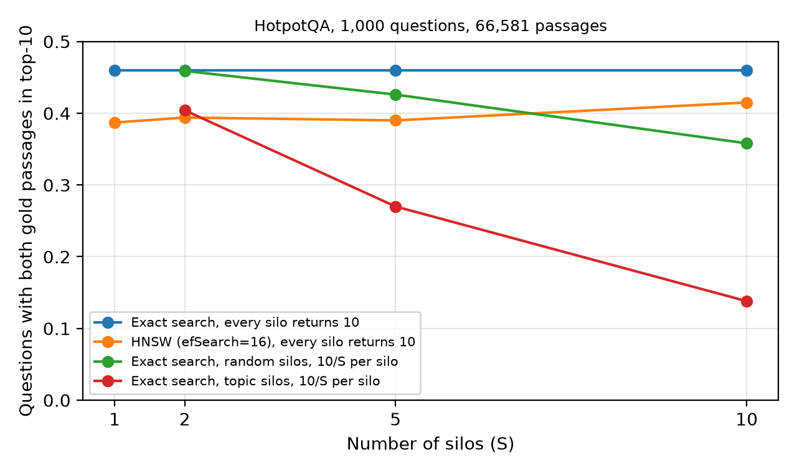

# What does it cost to search data that cannot be merged?

A small experiment, still in progress. I built it while preparing a research internship
application, because of a problem I hit in my own project
[CivicLens](https://github.com/thirthpatel2-web/Civiclens): government departments can only
share data with consent, so their documents cannot go into one central search index.

**Question:** if the documents are split across separate "silos", each with its own vector
index, how much retrieval quality do we lose, and where does the loss come from?

## Setup

- **Data:** the [HotpotQA](https://hotpotqa.github.io/) distractor validation set. Every
  paragraph in it (66,581 unique Wikipedia paragraphs) forms the corpus; 1,000 questions are
  sampled with a fixed seed. Each question has two gold "supporting" paragraphs.
- **Embeddings:** `all-MiniLM-L6-v2` (384 dimensions), the same model for every silo.
- **Silos:** 1 (central), 2, 5 or 10 silos, built either by topic (k-means on the embeddings)
  or at random.
- **Indexes (Faiss):** Flat (exact), HNSW (M=32, efSearch 16 or 64), IVF-PQ
  (nlist = sqrt(n), 16 sub-quantizers of 8 bits, nprobe 1 or 8).
- **Federated search:** query every silo, merge all candidates by score, keep the top 10.
  Each silo returns either 10 results ("full") or ceil(10/S) ("budget").
- **Metrics:** overlap with the exact central top-10, share of gold paragraphs found, and
  share of questions with *both* gold paragraphs in the top-10 (multi-hop questions need both).

## Results so far (1,000 questions, k = 10)



| Setting | Both gold in top-10 |
|---|---|
| Central exact index | 46.0% |
| Any number of silos, exact search, every silo returns 10 | 46.0% (identical to central) |
| Central HNSW, efSearch=16 | 38.7% |
| 10 topic silos, HNSW efSearch=16, every silo returns 10 | 41.5% |
| 10 random silos, exact, 1 result per silo | 35.8% |
| 10 topic silos, exact, 1 result per silo | 13.8% |
| Central IVF-PQ, nprobe=8 (16 x 8-bit codes) | 16.3% |

What I take from this so far:

1. **Splitting alone costs nothing.** With exact search, full results from every silo and
   merging by score (one shared embedding model), the merged top-10 is identical to the
   central top-10, as expected.
2. **Per-silo approximate search did not get worse with more silos.** HNSW on smaller
   per-silo indexes found slightly *more* of the exact neighbours (overlap 0.88 central vs
   0.93 with 10 topic silos at efSearch=16), at the price of searching more indexes.
3. **Result budgets are the big loss, and they hurt topic silos most.** When each silo may
   return only ceil(10/S) results, topic silos drop from 46.0% to 13.8% at 10 silos, because
   the relevant paragraphs for a question tend to sit in the same silo. Random silos lose
   much less (35.8%).
4. **Aggressive compression (IVF-PQ with 16 x 8-bit codes, no re-ranking) cost far more than
   graph-based search** in this setting. I have not yet tried re-ranking or larger codes.

## Limitations and next steps

- Retrieval only. Next: generate answers with a small open model and check whether these
  retrieval losses change the final answer.
- One embedding model shared by all silos (optimistic), one dataset, one run per setting.
- Timings were measured on a laptop CPU while other jobs were running, so I do not report them.
- Next: smarter budgets (ask more results from the silos that look most relevant) and
  choosing silos with a language model.

## Run it

```
pip install faiss-cpu sentence-transformers pyarrow matplotlib
# download HotpotQA distractor validation parquet into data/ (see prepare.py)
python prepare.py 1000      # corpus, questions, embeddings (~40 min on a laptop CPU)
python federated_ann.py     # all settings -> results/results.json
python plot.py              # chart
```
