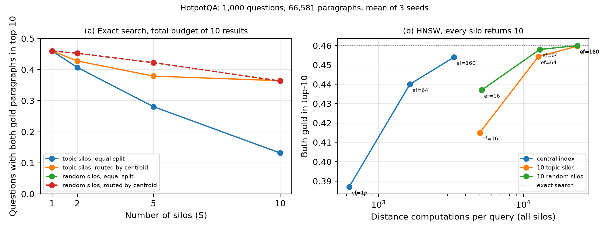

# What does it cost to search data that cannot be merged?

A small experiment, still in progress. I built it while preparing a research internship
application, because of a problem I hit in my own project
[CivicLens](https://github.com/thirthpatel2-web/Civiclens): government departments can only
share data with consent, so their documents cannot go into one central search index.

**Question:** if the documents are split across separate "silos", each with its own vector
index, how much retrieval quality do we lose, and where does the loss come from?

## Setup

- **Data:** the [HotpotQA](https://hotpotqa.github.io/) distractor validation set. Every
  paragraph in it (66,581 unique Wikipedia paragraphs) forms the corpus; 1,000 questions are
  sampled with a fixed seed. Each question has two gold "supporting" paragraphs, and both are
  needed to answer it.
- **Embeddings:** `all-MiniLM-L6-v2` (384 dimensions), the same model for every silo.
- **Silos:** 1 (central), 2, 5 or 10, built by topic (spherical k-means) or at random, each
  with 3 seeds.
- **Indexes (Faiss):** Flat (exact), HNSW (M=32, efSearch 16/64/160), IVF-Flat (nprobe 1/8),
  IVF-PQ (16 x 8-bit codes, nprobe 8) with exact re-ranking of 4x candidates so that scores
  from different silos are comparable.
- **Federated search:** query every silo and merge candidates by score into a top-10. Result
  budgets:
  - `full`: every silo returns 10 (no budget)
  - `equal`: every silo returns ceil(10/S)
  - `routed`: a total of 10 results shared across silos in proportion to how similar the
    query is to each silo's centroid (softmax, temperature 0.05)
- **Metrics:** share of questions with *both* gold paragraphs in the top-10 (mean of 3 seeds,
  95% bootstrap interval over questions in `results.json`), overlap with the exact central
  top-10, distance computations per query (a hardware-independent measure of search effort),
  and the share of questions whose two gold paragraphs sit in the same silo.

## Results



In panel (a) the two random-silo lines lie on top of each other.

| Setting | Both gold in top-10 | Search effort per query |
|---|---|---|
| Central exact index | 46.0% | 66,581 |
| Any number of silos, exact search, every silo returns 10 | 46.0% | 66,581 |
| 10 topic silos, exact, equal budget (1 per silo) | 13.2% | 66,581 |
| 10 topic silos, exact, routed budget | 36.4% | 66,581 |
| 10 random silos, exact, equal or routed budget | 36.3% | 66,581 |
| Central HNSW, efSearch 64 | 44.0% | 1,645 |
| Central HNSW, efSearch 160 | 45.4% | 3,314 |
| 10 topic silos, HNSW efSearch 16, every silo returns 10 | 41.5% | 5,003 |
| 10 topic silos, HNSW efSearch 64, every silo returns 10 | 45.4% | 12,702 |
| Central IVF-Flat, nprobe 8 | 35.5% | 2,239 |
| Central IVF-PQ + re-ranking, nprobe 8 | 23.6% | 2,279 |

What I take from this:

1. **Splitting alone costs nothing.** With exact search, full results from every silo and one
   shared embedding model, the merged top-10 is identical to the central one.
2. **Federation costs search effort.** To reach 45.4%, the central HNSW index needs about
   3,300 distance computations per query; 10 topic silos need about 12,700, roughly 4x more,
   because every query searches 10 graphs. (An earlier version of this README said per-silo
   HNSW was "better"; that ignored the extra work.)
3. **A fixed per-silo budget hurts topic silos badly, and it is largely structural.** With 10
   topic silos, both gold paragraphs sit in the same silo for 57% of questions (77% at 2 silos,
   61% at 5), so one result per silo can never return both for those questions: 46.0% falls
   to 13.2%.
4. **Routing the same total budget by silo similarity recovers most of that loss** (13.2% to
   36.4% at 10 topic silos). With random silos the centroids are nearly identical, so routing
   cannot help and equals the equal split (36.3%).
   Because most silos get a budget of zero, they need not be searched at all: each query then
   searches on average 2.2 of 10 silos, about 15,400 distance computations instead of 66,581
   (77% less) for the same 36.4% (`routing_cost.py`, 3 seeds).
6. **Nearest-neighbour recall underrates what RAG keeps.** With 5 topic silos and an equal
   budget, only 36% of the exact central top-10 survives, but the both-gold rate keeps 61% of
   its central value (28.1% vs 46.0%). A budget predictor trained on nearest-neighbour labels
   may therefore optimise the wrong target.
5. **Compression still loses candidates.** Even with exact re-ranking, IVF-PQ found fewer gold
   pairs than IVF-Flat at the same nprobe (23.6% vs 35.5% centrally).

## Limitations and next steps

- Retrieval only. Next: generate answers with a small open model and check whether these
  retrieval losses change the final answer.
- One embedding model shared by all silos (optimistic); real organisations may use different
  models, which makes scores harder to merge.
- The corpus is HotpotQA's distractor paragraphs, which were chosen to look like the gold ones,
  so it is harder and much smaller than a real corpus.
- Routing uses a simple centroid score; next I want to compare it with classic resource
  selection methods and with a language model choosing the silos.
- `results/v1/` keeps the first version of the results (one seed, unfair IVF-PQ merge) for
  transparency.

## Run it

```
pip install faiss-cpu sentence-transformers pyarrow matplotlib numpy
# download the HotpotQA distractor validation parquet into data/ (URL in prepare.py)
python prepare.py 1000      # corpus, questions, embeddings (~40 min on a laptop CPU)
python federated_ann.py     # all settings -> results/results.json (~45 min)
python plot.py              # charts
python routing_cost.py      # search cost when zero-budget silos are skipped
```
